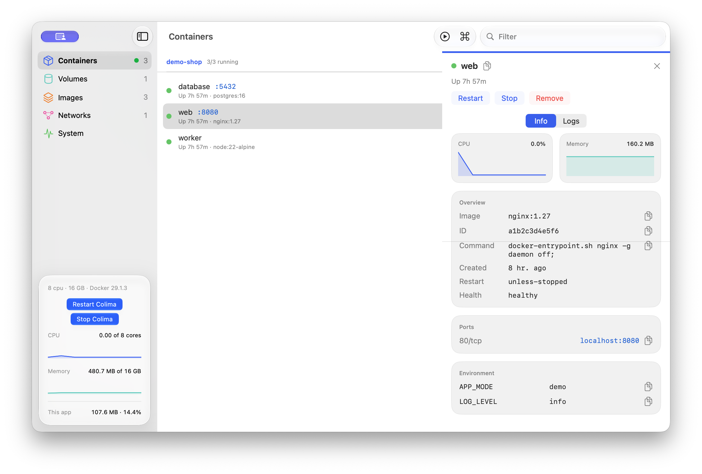
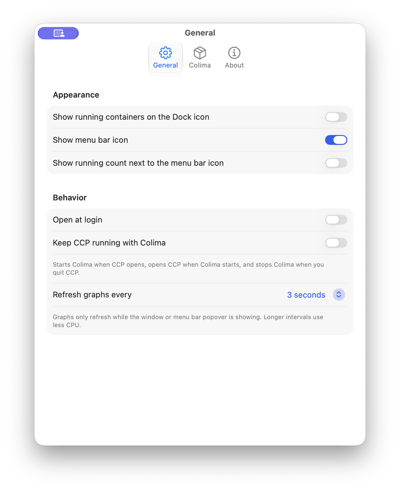

<p align="center">
  
</p>

# Colima Control Panel

A native macOS dashboard and menu bar companion for [Colima](https://github.com/abiosoft/colima). Browse containers, images, volumes, and networks, watch resource use, and manage your VM from one place.

This is an independent project and is not affiliated with Colima or its maintainers.

## Screenshots

Screenshots use sample Docker data.





## Install

Colima Control Panel requires macOS 26 or later, Colima, the Docker CLI, and Xcode 26 or later to build.

```sh
brew install colima docker
git clone https://github.com/mxttbennett/colima-control-panel.git
cd colima-control-panel
scripts/build-app.sh
open "build/Colima Control Panel.app"
```

Move the app to `/Applications` to keep it. Builds use an ad hoc signature, so macOS may ask you to right-click the app and choose Open the first time.

## Use

- Start, stop, and restart Colima from the sidebar.
- Browse containers by Compose project. Select a container to see its health, ports, environment, logs, and resource graphs.
- Inspect images, volumes, and networks, and remove or prune them with confirmation.
- Press **⌘K** for the command palette, `/` to filter, and use arrow keys to move through containers.
- Set `COLIMA_PROFILE=work` when launching CCP to use a profile other than `default`.
- Enable **Keep CCP running with Colima** in Settings to have CCP start Colima when it opens, open when Colima starts externally, and stop Colima when CCP quits. This option is off by default.

## How it works

CCP reads Docker data from `~/.colima/<profile>/docker.sock`. It does not run a network service or send data off your Mac.

When **Keep CCP running with Colima** is enabled, a small bundled LaunchAgent checks the active profile's Docker socket every three seconds. It opens CCP when Colima starts and keeps watching after CCP quits. CCP saves the active profile so the helper can follow it.

## Develop

```sh
swift test
scripts/build-app.sh
```

The tests include Docker API checks against a running Colima socket. They skip those checks when Colima is stopped. `scripts/render-icon.swift` renders the artwork used by the app icon.

See [docs/releasing.md](docs/releasing.md) for packaging and Homebrew release steps.

## License

[MIT](LICENSE)
