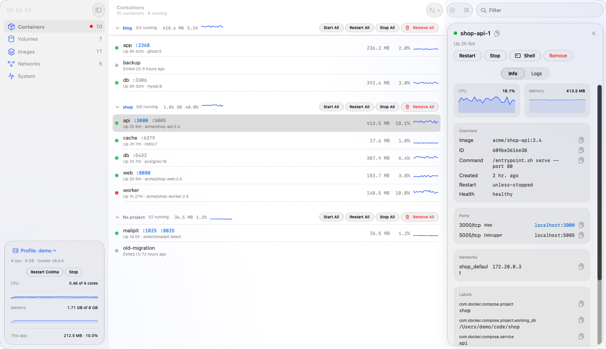
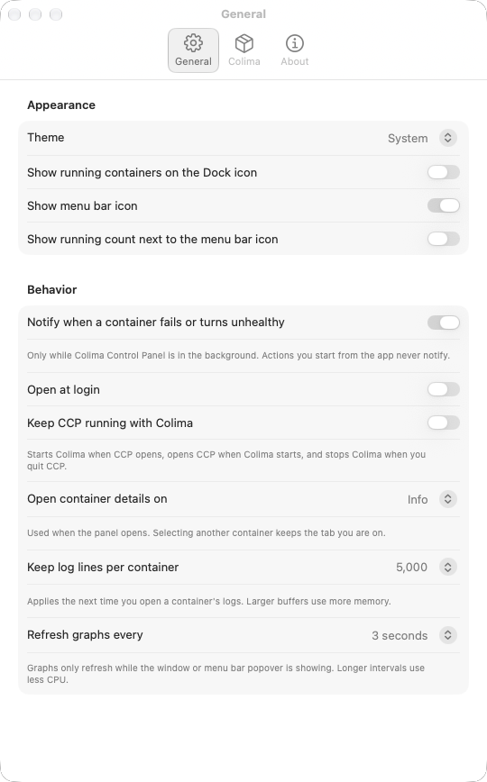

<p align="center">
  
</p>

# Colima Control Panel

A native macOS dashboard and menu bar companion for [Colima](https://github.com/abiosoft/colima). Browse containers, images, volumes, and networks, watch resource use, and manage your VM from one place.

This is an independent project and is not affiliated with Colima or its maintainers.

## Screenshots

Screenshots use sample Docker data.





## Install

Colima Control Panel requires macOS 26 or later, Colima, the Docker CLI, and Xcode 26 or later to build.

```sh
brew install colima docker
git clone https://github.com/mxttbennett/colima-control-panel.git
cd colima-control-panel
scripts/build-app.sh
open "build/Colima Control Panel.app"
```

Move the app to `/Applications` to keep it. Builds use an ad hoc signature, so macOS may ask you to right-click the app and choose Open the first time.

## Use

- Start, stop, and restart Colima from the sidebar. When more than one profile exists, a profile menu above the controls switches between them. `COLIMA_PROFILE=work` still picks the profile at launch.
- Browse containers by Compose project. Click a project header to collapse it. Each header has Start, Restart, Stop and Remove for the whole project, and a folder menu to reveal the project folder in Finder or open it in Terminal. Containers that belong to no project get the same buttons.
- Sort containers by name, CPU, memory or uptime from the toolbar. Rows show memory and CPU beside a live graph.
- Select a container to see its health, exit code, restart count, ports, mounts, networks, labels and environment. Filter the environment, reveal secret values, or copy it as `KEY=value` lines. Drag the panel's left edge to resize it, and double-click the edge to reset the width.
- Read logs in the Logs tab. Levels are colored, links are clickable, and the filter highlights matches with a count and Next and Previous buttons. Options let you wrap lines, hide timestamps, show matches in context, and save the log to a file.
- Open a shell in Terminal from the Shell button or the context menu.
- Inspect images, volumes, and networks, sort the tables, and remove or prune them with confirmation. Pull an image from the Images toolbar.
- The System view shows disk use by category and how much each prune would reclaim.
- Get a notification when a container exits with an error or turns unhealthy while the app is in the background. Turn it off in Settings.
- The menu bar popover lists running containers. Hover a row to restart or stop it, or use Stop All.

### Keyboard

| Keys | Action |
| --- | --- |
| ⌘K | Command palette: views, Colima, containers, projects, pull, prune, profile, sort |
| `/` | Filter the current list |
| ⌘1 to ⌘5 | Containers, Volumes, Images, Networks, System |
| ⌘I, ⌘L | Show the selected container's info or logs |
| ⌘R, ⇧⌘R, ⌘. | Restart, start, or stop the selection |
| ⌘⌫ | Remove the selection, with confirmation |
| Return | Open logs for the selected container |
| ⌘G, ⇧⌘G | Next and previous log match |

Enable **Keep CCP running with Colima** in Settings to have CCP start Colima when it opens, open when Colima starts externally, and stop Colima when CCP quits. This option is off by default. Settings also sets the log buffer size, the tab a container opens on, and how often graphs refresh.

## How it works

CCP reads Docker data from `~/.colima/<profile>/docker.sock`. It does not run a network service or send data off your Mac.

When **Keep CCP running with Colima** is enabled, a small bundled LaunchAgent checks the active profile's Docker socket every three seconds. It opens CCP when Colima starts and keeps watching after CCP quits. CCP saves the active profile so the helper can follow it.

## Develop

```sh
swift test
scripts/build-app.sh
```

The tests include Docker API checks against a running Colima socket. They skip those checks when Colima is stopped. `scripts/test-reclick.sh` checks the re-click-to-deselect behavior against a real table. It needs a desktop session and moves the pointer for a moment. `scripts/render-icon.swift` renders the artwork used by the app icon.

See [docs/releasing.md](docs/releasing.md) for packaging and Homebrew release steps.

## License

[MIT](LICENSE)
